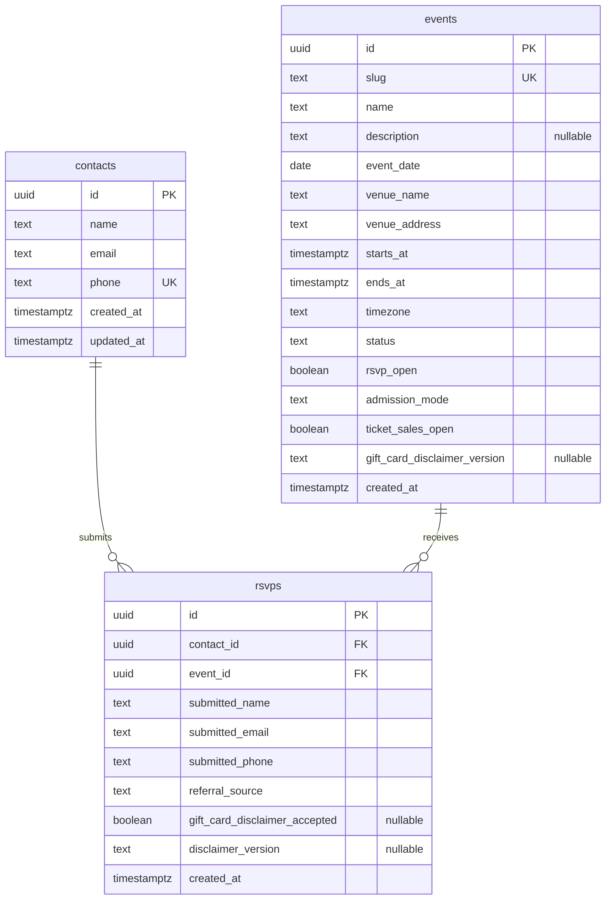

# Recurring-event database model

Status: normalization migration applied by the owner. The application now uses normalized RPC submission on this branch. The follow-up RPC migration has been tested only on LOCAL Supabase and awaits review before any remote application. See [the implementation and testing guide](rsvp-submission.md).

This design follows the agreed rules: one normalized phone identifies one contact, a contact can register once per event, contacts hold current profile details, and RSVPs preserve the details submitted for each event. Each dated occurrence is a separate event. Event-series modeling remains deferred. Paid admission is implemented separately alongside RSVP; see the ticketing section below.

## Relationships

Every RSVP references exactly one contact and one event. Both parents may have zero or many RSVPs. The composite uniqueness rule is `(contact_id, event_id)`; the diagram's individual foreign-key markers do not imply that either column is individually unique.

## Contacts

| Column       | Type          | Nullable | Rules and defaults                                                                                          |
| ------------ | ------------- | -------- | ----------------------------------------------------------------------------------------------------------- |
| `id`         | `uuid`        | No       | Primary key; database-generated UUID. Permanent identity referenced by other tables.                        |
| `name`       | `text`        | No       | Current name; trimmed, nonblank, 1–100 characters.                                                          |
| `email`      | `text`        | No       | Current email; lowercase, trimmed, 3–254 characters, existing basic database email-shape check. Not unique. |
| `phone`      | `text`        | No       | Unique canonical E.164 number; shape `^\+[1-9][0-9]{1,14}$`.                                                |
| `created_at` | `timestamptz` | No       | Database-generated insertion time.                                                                          |
| `updated_at` | `timestamptz` | No       | Initially insertion time; database-maintained when profile values change; must not precede `created_at`.    |

Phone is text because it contains a leading plus sign and is an identifier, not a quantity. Country-aware validation and E.164 normalization remain server responsibilities; a shape check alone does not establish validity or ownership. The server currently defaults national-format numbers to US and rejects extensions.

`UNIQUE(phone)` is required by the agreed one-phone/one-contact policy. The UUID remains the permanent relational identity; the phone is the current matching key. Shared numbers cannot represent separate contacts under this policy. Phone changes or recycled-number disputes require an owner-reviewed identity correction, not automatic matching by name or email. Preserve historical RSVP snapshots during any correction and check for event-registration collisions before merging contacts.

Email must not be unique: different people can share an address, and a person's address can change. Names are also non-unique. Matching an existing email with a different phone must not automatically merge contacts.

Keep the existing database name minimum of one character so valid legacy records are not rejected. The public form may continue requiring two characters and applying its stricter name validation. Do not add stricter database checks during backfill without auditing existing data first.

## Events

| Column                         | Type          | Nullable | Rules and defaults                                                                                                                            |
| ------------------------------ | ------------- | -------- | --------------------------------------------------------------------------------------------------------------------------------------------- |
| `id`                           | `uuid`        | No       | Primary key; database-generated UUID.                                                                                                         |
| `slug`                         | `text`        | No       | Unique; 1–120 characters; lowercase hyphen-separated alphanumeric segments, matching the existing slug validation.                            |
| `name`                         | `text`        | No       | Trimmed, nonblank event title.                                                                                                                |
| `event_date`                   | `date`        | No       | Explicit, finite local start date; no default. Must equal the calendar date of `starts_at` in `timezone`. Not unique.                         |
| `description`                  | `text`        | Yes      | Optional plain-text description; use null for absence; if present, trimmed and nonblank.                                                      |
| `venue_name`                   | `text`        | No       | Trimmed, nonblank; current scope is in-person events.                                                                                         |
| `venue_address`                | `text`        | No       | Trimmed, nonblank; store the display address without prematurely splitting it into address tables.                                            |
| `starts_at`                    | `timestamptz` | No       | Exact start instant; no default.                                                                                                              |
| `ends_at`                      | `timestamptz` | No       | Exact end instant; strictly after `starts_at`; no default.                                                                                    |
| `timezone`                     | `text`        | No       | Added to the proposed columns: valid IANA display timezone, explicitly supplied, e.g. `America/New_York`.                                     |
| `status`                       | `text`        | No       | Checked set: `draft`, `published`, `cancelled`, `completed`; default `draft`.                                                                 |
| `rsvp_open`                    | `boolean`     | No       | Default false. May be true only when status is `published`.                                                                                   |
| `gift_card_disclaimer_version` | `text`        | Yes      | Added by the follow-up RPC migration. Null means no promotion; otherwise a trimmed 1–100-character supported version requires acknowledgment. |
| `created_at`                   | `timestamptz` | No       | Database-generated insertion time.                                                                                                            |

The status values and event-field nullability above are recommended conventions for this target design. Complete venue and schedule details are required even for drafts; supporting incomplete drafts would require relaxing those fields and validating completeness before publishing.

Use checked text for status rather than a PostgreSQL enum for now, keeping lifecycle changes straightforward. Status describes lifecycle; `rsvp_open` controls registration independently within the published state. A published event may have registration closed. Closing registration does not delete or invalidate existing RSVPs. Cancellation/completion must also set `rsvp_open` false.

Event names may repeat across occurrences. `event_date` distinguishes their calendar dates without embedding dates in the name. Store a PostgreSQL `date` such as `2026-10-26`, and format it as **October 26, 2026** in the presentation layer; do not store the English display string. Names and dates are not unique, individually or together: separate events can share a title and date. UUIDs identify events and slugs remain unique.

`timestamptz` stores an instant, not the event's original IANA timezone, so retain `timezone` separately for display and daylight-saving behavior. The migration validates timezone names against PostgreSQL's timezone catalog on event insert/timezone update. A database check enforces `event_date = (starts_at AT TIME ZONE timezone)::date`, independent of the database session timezone. Change the date, start instant, and timezone together when rescheduling if necessary. Overnight events retain the date on which they start, even when `ends_at` falls the next day. When formatting a date-only value, avoid conversion to an instant that could shift it to the previous day in another timezone.

Event dates, timestamps, and venue metadata must be confirmed during legacy backfill rather than inferred from the slug. The existing event remains **October 12, 2026**; October 26 is a formatting example, not a replacement for historical event metadata.

Keep time-dependent registration eligibility in the trusted submission operation, not a check constraint involving the current time. For this scope, registration requires a published event, `rsvp_open = true`, and submission before `starts_at`. The operation must coordinate with event closure so concurrent submissions cannot bypass a committed closure.

The server discovers all published/open/future events through the restricted discovery RPC, ordered by start time and UUID. The homepage defaults to the next event and provides links to the others. No hardcoded or environment-selected event slug is needed. A form is bound server-side to its displayed event; its Server Action and the transactional RPC revalidate eligibility. Browser selection is navigation, never authorization. Slugs serve routing and lookup; foreign keys use event UUIDs so URL changes do not break relationships.

## RSVPs and historical information

| Column                          | Type          | Nullable | Rules and defaults                                                                                                                           |
| ------------------------------- | ------------- | -------- | -------------------------------------------------------------------------------------------------------------------------------------------- |
| `id`                            | `uuid`        | No       | Primary key; database-generated for new RSVPs; preserve existing IDs during migration.                                                       |
| `contact_id`                    | `uuid`        | No       | Foreign key to `contacts.id`; restrict parent deletion and primary-key updates.                                                              |
| `event_id`                      | `uuid`        | No       | Foreign key to `events.id`; restrict parent deletion and primary-key updates.                                                                |
| `submitted_name`                | `text`        | No       | Added historical snapshot; same database shape checks as contact name.                                                                       |
| `submitted_email`               | `text`        | No       | Added historical snapshot; same normalization and database shape checks as contact email. Not unique.                                        |
| `submitted_phone`               | `text`        | No       | Added historical snapshot; E.164 shape check. Not individually unique.                                                                       |
| `referral_source`               | `text`        | No       | Existing checked values: `Instagram`, `WhatsApp`, `Friend / Word of mouth`, `Guantanamera`, `Dance class / studio`, `Other`.                 |
| `gift_card_disclaimer_accepted` | `boolean`     | Yes      | Null when no promotion applies; otherwise true with a version. Keep the existing true-only check and no default; never infer acceptance.     |
| `disclaimer_version`            | `text`        | Yes      | Null only when acknowledgment is null; otherwise trimmed, 1–100 characters, with trusted server-supplied version and archived exact wording. |
| `created_at`                    | `timestamptz` | No       | Database-generated submission time for new records; preserve existing timestamps.                                                            |

The proposed RSVP columns alone cannot preserve historical contact information: joining an old RSVP to a changed contact would show today's name/email. Therefore add `submitted_name`, `submitted_email`, and `submitted_phone`. These are immutable submission facts, intentionally distinct from the mutable contact profile. Do not constrain snapshots to equal the current contact fields.

Example: October's RSVP contains `submitted_email = old@example.com`. A successful November RSVP with the same phone contains `submitted_email = new@example.com`, and the contact now has `email = new@example.com`. October remains unchanged. Apply the same rule to name changes.

Referral and disclaimer evidence remain event-registration facts, not contact-level attributes. Current consent is specific to the Guantanamera promotional phone-sharing notice; it is not general marketing consent or evidence of gift-card eligibility. Archive each disclosure version's exact wording in version control. The existing submission timestamp is the recorded submission time, not a separately measured acceptance timestamp.

Future events without the promotion store null in both disclaimer fields. A pair check permits only null/null or true/non-null; existing format checks reject invalid versions and false acknowledgment. The migration preserves all October 12 values exactly and keeps its strict historical preflight. Trusted event configuration in the future submission operation determines whether the promotion applies and requires acknowledgment when appropriate; nullability alone does not encode event applicability. Do not default acceptance to true or fabricate a version. No generic consent-management tables are introduced. The form/server now use the event’s version, show acknowledgment only when required, and fail closed for unsupported versions.

Snapshots preserve attendee submission history. This design does not version every edit to an event's title, venue, or schedule; add event revision history separately if that becomes a requirement.

## Uniqueness and indexes

| Constraint or index                  | Purpose                                                                                                                  |
| ------------------------------------ | ------------------------------------------------------------------------------------------------------------------------ |
| Primary key on each table's `id`     | Stable row identity; each primary key supplies its own unique index.                                                     |
| Unique `contacts.phone`              | Atomic one-contact-per-normalized-phone matching, including concurrent requests. Supplies the phone lookup index.        |
| Unique `events.slug`                 | Prevent duplicate event URLs and support slug lookup. Supplies its own index.                                            |
| Index `events(event_date)`           | Supports calendar-date filtering and chronological event lists; dates remain non-unique.                                 |
| Unique `rsvps(contact_id, event_id)` | Atomic one-RSVP-per-contact-per-event rule. Also supports contact attendance-history lookup and the contact foreign key. |
| Index `rsvps(event_id, created_at)`  | Supports event attendee lists in submission order and the event foreign key.                                             |

Yes, use `UNIQUE(contact_id, event_id)`. Reversing the order enforces the same uniqueness, but the chosen contact-first order plus the event-first listing index covers both access paths without extra single-column foreign-key indexes. Do not make either RSVP foreign key unique by itself: that would prevent repeat attendance or prevent multiple attendees at an event.

Do not create duplicate indexes on phone, slug, or contact ID when the indexes above already cover those lookups. Email indexes and additional event timestamp/status indexes should be added when actual query patterns justify them. Email has no uniqueness constraint.

During the rollback window, the existing `rsvps_event_phone_key UNIQUE(event_slug, phone)` and required legacy name/email/phone/slug columns remain alongside normalized uniqueness. The new writer must populate legacy values consistently with the event and submission snapshots. Remove the redundant legacy constraint/columns only in a separately reviewed cleanup after cutover verification and the rollback window. Snapshot columns and normalized uniqueness remain permanently. Retention does not make an application-only rollback sufficient to restore writes.

## Submission, updates, and access

One trusted, atomic database operation must resolve or create the contact by normalized phone, validate event availability, create the RSVP snapshots, and update the contact's current name/email. All changes commit together or roll back together. Concurrent phone creation and same-event submissions must be resolved through the unique constraints, not a check-then-insert sequence alone.

A duplicate for the same event returns the duplicate result and changes neither the existing RSVP nor the contact profile. A successful registration for another event may update the current profile. Concurrent successful registrations for different events serialize contact updates; the last applied profile update wins. Backfilled profiles need a separate deterministic source-selection rule, not migration execution order.

There is no phone-ownership verification today. Under the agreed rule, an unverified new-event submission can update the matched contact's current name/email. Do not treat that match as authentication, return saved personal information, or grant account/payment access based on it. Future ownership verification can strengthen this without changing UUID relationships.

Enable RLS on the new tables and retain revoked browser access to contacts and RSVPs. Preserve server-only event management for this scope; public event presentation can use server-selected fields. Before migration the service role has only RSVP INSERT; after migration it has no table privileges on contacts, events, or RSVPs. The old direct-insert implementation cannot write; the new implementation receives only RPC execution capability. RLS bypass does not replace SQL table privileges. Keep registration closed in environments where the follow-up RPC migration is not yet applied. No broad grants are added to preserve the old action. Rate-limit permissions remain unchanged. Keep snapshots immutable through application permissions and use stable event identity in event-specific limiter keys.

The exact next implementation contract, including transactional contact creation, row locking, duplicate handling, event-specific acknowledgment and restricted execution, is documented in [the submission operation runbook](database-migration.md#required-normalized-submission-operation).

## Data-preserving migration approach

After explicit approval to generate migration SQL:

1. Inspect the live schema, applied migration history, constraints, permissions, row counts, distinct slugs and normalized phones, and profile conflicts using read-only queries. Repository migrations do not prove production has no schema drift.
2. Back up existing data and rehearse restoration and migration on an isolated copy. Confirm the deployed registration state before choosing a controlled cutover window; use a brief submission pause unless a tested compatibility path supports concurrent old/new writes.
3. Add contacts, events, and initially nullable RSVP relationship/snapshot columns. Keep all original RSVP columns, values, IDs, timestamps, and existing uniqueness protection throughout the transition. Do not rewrite applied migrations.
4. Create one event per distinct legacy slug with confirmed metadata. Create one contact per exact normalized phone. Select the most recent RSVP's name/email by original `created_at`, with UUID as a deterministic tie-breaker; review conflicting profiles and any invalid legacy values before proceeding. Set new contact timestamps to actual contact creation/update times rather than inventing historical contact edits.
5. Link every RSVP to its contact and event. Copy legacy name/email/phone exactly into snapshots. Preserve referral, acknowledgment, disclaimer version, ID, and original creation time. Do not delete duplicates or silently repair conflicting data; investigate discrepancies.
6. Reconcile row counts, original column values, snapshot values, mapping coverage, orphan checks, and pair uniqueness. Validate new foreign keys and checks, enforce non-null relationships, and retain legacy columns for rollback.
7. Deploy the atomic submission flow and explicit permissions. Update duplicate-constraint handling, event selection/open state, rate-limit identity, and relevant database/concurrency tests. Exercise changed-email history, same-event duplicates, shared-email contacts, and rollback on failure.
8. Switch reads to the normalized model and monitor. Replace the old event/phone constraint only once the new constraints and writer are active. Any later removal or renaming of legacy columns requires a separately reviewed cleanup after the rollback window; original snapshots must remain.

No existing RSVP data is to be deleted by this migration. The unrelated private rate-limit table and its data are not part of contact normalization.

## Paid admission

`events.admission_mode` is non-null text with a check allowing rsvp/ticketed, default rsvp. `events.ticket_sales_open` is non-null boolean, default false. These are added by the new paid-ticket migration; rsvp_open continues to control RSVP mode only.

The additive paid-ticket migration adds ticket_types, orders, tickets, and stripe_events. Orders and tickets each independently enforce UNIQUE(contact_id,event_id); tickets also enforce unique order_id. A verified payment webhook transaction issues one ticket. RSVP records remain separate and never prove payment. Events default to admission_mode=rsvp; ticketed events use ticket_sales_open and an active ticket type. See [ticketing.md](ticketing.md) for the complete model, security boundary and ER diagram.

Paid-ticket MVP (additive migration, local setup, security and production checklist): [ticketing documentation](ticketing.md). RSVP remains available for RSVP-mode events.

The additive `20261020203257_ticket_purchase_recovery.sql` migration tracks an order's payment attempt number/start time and superseded canceled Stripe intent IDs. A server-only recovery RPC rotates the browser capability only after Stripe cancellation, under a row lock with an expected-attempt check. Order/contact/event uniqueness and webhook-only ticket fulfillment remain unchanged. Paid orders cannot be recovered into a new payment. See [ticket recovery](ticketing.md) for the transaction boundaries and remaining ambiguous-intent limitation.

QR display uses the existing unique ticket_token; no QR identifier/image column is added. The read-only `20261020213352_ticket_qr_display.sql` migration adds a service-role-only token lookup and includes the fulfilled token in the purchase-capability read. The QR payload is the canonical SITE_URL + `/tickets/` + ticket_token. Viewing the ticket never changes checked_in_at or payment/fulfillment state.

The additive `20261026155352_ticket_sales_5pm_eastern.sql` migration replaces the earlier noon policy with 5 PM Eastern on event_date, using America/New_York for daylight saving. It updates ticket-type cap enforcement, discovery and transactional initialization. Only old default noon/NULL deadlines for events that have not ended are extended; earlier custom windows, historical windows, sales-open flags, orders, tickets, identity, fulfillment, permissions and RSVP history are preserved. The earlier noon migration is not edited. Existing intents are not automatically canceled; see [the cutoff details](ticketing.md#5-pm-eastern-sales-closure).

The additive `20261021174535_ticket_email_delivery.sql` migration adds nullable `tickets.email_attempted_at` and `email_sent_at` timestamps plus two service-role-only RPCs. A conditional atomic claim verifies the stored paid order/intent and valid ticket before returning the order email snapshot and ticket details; duplicate calls return NULL. Gmail sending occurs after the existing fulfillment transaction. Claims never expire automatically, preventing duplicate SMTP sends after ambiguous failures. Existing grants, identity constraints and fulfillment SQL are unchanged. Applied only locally; see [ticket-email.md](ticket-email.md) for the manual recovery procedure and SMTP delivery limits.

Ticketed gift-card events use the additive `20261021191406_ticket_gift_card_disclaimer.sql` migration. Orders hold a nullable paired `gift_card_disclaimer_accepted`/`disclaimer_version` purchase snapshot; non-promotion orders remain NULL/NULL. initialize_ticket_order uses two optional acknowledgment parameters and enforces the server-resolved event's exact supported version before writes. Existing RSVP consent is untouched. See [the October 26 event setup](event-2026-10-26.md).
