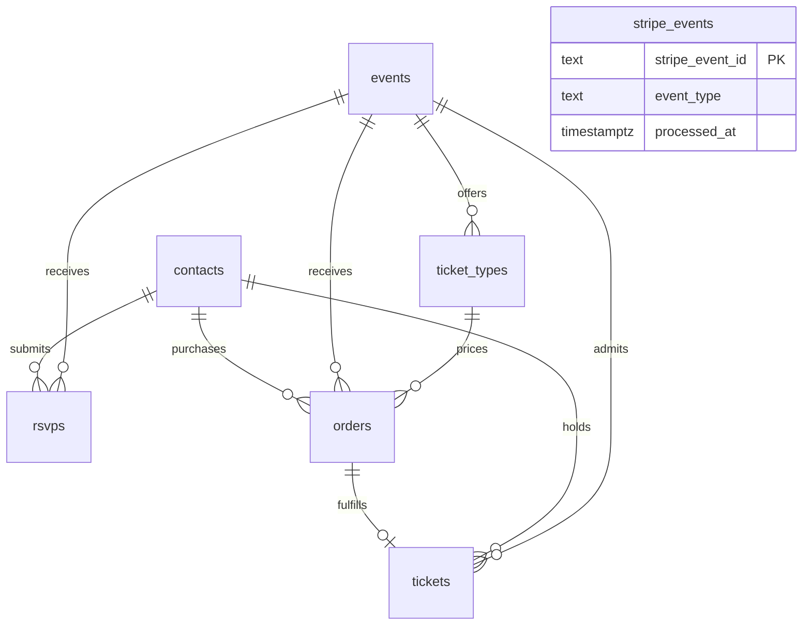

# Paid-ticket MVP

RSVP and paid admission coexist. `events.admission_mode` defaults to `rsvp`; all existing events and historical RSVP data stay intact. No real paid event is invented by the migration.

## Database and security

New migration: `supabase/migrations/20261020182215_paid_ticket_mvp.sql`. Apply only after reviewing it; never edit earlier migrations.

- `events`: adds `admission_mode` (`rsvp`/`ticketed`) and independent `ticket_sales_open` (default false).
- `ticket_types`: positive integer cents, USD, optional sales window, at most one active type per event. A published/future ticket event is discoverable/purchasable only with open sales and an active type inside its window.
- `orders`: one immutable attendee/referral snapshot and one price snapshot per order. `UNIQUE(contact_id,event_id)`, unique PaymentIntent ID. Pending orders are reused; paid/refunded/void orders cannot open another payment. No quantity or order_items.
- `tickets`: unique order and contact/event; composite foreign key ensures event/contact/type match the order. Valid/refunded/void. Random 256-bit token stays private; random 12-hex-character `EST-` code is shown for support. A token/code collision aborts fulfillment; a webhook retry generates fresh values.
- `stripe_events`: Stripe event ID deduplicates transactional processing.

RLS is enabled on every new table, without browser policies. Direct table CRUD remains revoked from PUBLIC, anon, authenticated, and service_role. Only service_role can execute the narrow ticketing SECURITY DEFINER functions, each with an empty search_path and qualified table references. Existing discovery/RSVP functions are updated in this new migration only. Ticketed events cannot use the RSVP write/lookup to bypass purchase.



## Browser and server flow

1. Database-driven discovery returns eligible RSVP and ticket events. The page server binds the selected event slug to its purchase Server Action. Browser prices, contact IDs, event IDs, currency, and statuses are ignored.
2. Get Ticket stays on the page and smoothly scrolls/focuses the visible purchase section. Clicking it creates no order.
3. The ticket form reuses the RSVP container/layout and shared input/label styles. The original RSVP form is preserved. Once all attendee fields are valid and input has settled for 800ms, one in-flight initialization runs automatically. There is no Continue button. The attendee details then lock; retries use that exact submission.
4. Existing RSVP validation performs country-aware E.164 parsing, name trimming/spacing, email normalization, and referral validation. Existing HMAC global/IP/phone limits constrain initialization. No raw card inputs exist in our form.
5. `initialize_ticket_order` locks event/type, checks eligibility, inserts contact ON CONFLICT(phone) DO NOTHING, locks the contact, and finds/creates its sole order. New orders capture database price and attendee/referral snapshots; contact current name/email update on first reservation, not on duplicate/reused orders. Each database RPC is one transaction.
6. Server creates/retrieves a PaymentIntent using the official SDK, database order amount/currency and metadata order_id/event_id/ticket_type_id. Stable Stripe idempotency key `ticket-order:<uuid>:v1` covers concurrent requests and network retries. The same fixed parameters are used on retry. It verifies the returned intent and stores the ID via a guarded RPC **before** returning a client secret.
7. Payment Element mounts with the Appearance API (paper/navy/red). Buy Now calls elements.submit(), then stripe.confirmPayment() with redirect: if_required and a server-configured SITE_URL return route. Normal cards stay on our page; required card authentication may visit the bank and return to `/ticket/return?event=<slug>`. A success response never updates order/ticket state.
8. Only a signature-verified webhook fulfills. Confirmation polls every 2s, up to 15 attempts, then offers refresh/support. A paid, valid ticket shows You're in!, event date/time/venue, type, authoritative amount, and ticket_code. Save/screenshot it for now.

Phone identifies a contact; **it is not authentication or proof of ownership**. A separate random 256-bit purchase credential for each event and normalized phone is persisted in localStorage under a SHA-256 phone lookup key (with sessionStorage/memory fallbacks); only its SHA-256 hash is stored in the order. Each tab keeps its own active attendee credential for confirmation/Stripe returns. Existing event-only credentials still open their saved confirmations; they are never blindly assigned to a newly entered phone. It authorizes the pending session/confirmation and never enters URLs. A different browser cannot receive an old client secret, saved payment method, or ticket code based on phone alone. Paid orders return generic `already_purchased`; the original credential is still required to see ticket details.

Recovery migration: `20261020203257_ticket_purchase_recovery.sql` (new; apply separately after review).

**Migration rollout compatibility:** The base ticketing migration exposes a three-argument `attach_ticket_payment_intent`. The recovery migration changes it to four arguments and adds `payment_attempt` to initialization results. The server preserves an absent attempt field (it does not default it to zero) and sends exactly three arguments to old databases. With the recovery migration installed, it sends the explicit attempt, including zero. New buyers and same-browser pending-order reuse work with either schema. Missing recovery support never triggers Stripe cancellation; lost-credential/canceled/non-card sessions instead receive a controlled recovery-unavailable response. To enable full recovery locally, review pending migrations, then run `npx supabase migration up --local`. Do not run against a linked/remote database. Deploy the compatible server before applying recovery; after migration, the guarded attachment signature requires the updated server. The migration is not a cure for an unrelated Stripe configuration or transport error; sanitized server logs identify the failing RPC and code.

For a missing credential, canceled intent, or older non-card intent, the server verifies amount/currency/metadata with Stripe, then cancels **only unpaid** attempts before rotating the purchase credential under a row lock and incrementing `payment_attempt`. The same order is retained; each replacement uses `ticket-order:<uuid>:v1:attempt:<n>` as its stable idempotency key. A compare-and-swap and attempt-aware intent attachment prevent concurrent requests from overwriting a newer session. The new browser must enter card details again. A cancellation/confirmation race is resolved by reading Stripe again: succeeded returns already purchased (or confirmation for the credential owner), processing is never canceled. Transient races/processing show a “Check payment status” action instead of the permanent pending_elsewhere error. Old failed webhooks for recorded superseded intents are acknowledged without changing payment or ticket state; successful fulfillment still requires the current bound intent and remains webhook-authoritative. Direct table privileges remain revoked; recovery RPC execution is service_role-only. Entering someone else’s phone can interrupt an unpaid attempt, so existing rate limits remain in force; this does not prove phone ownership.

PostgreSQL and Stripe cannot share a distributed transaction. If intent creation succeeds but ID storage fails, retrying within 23h uses the same idempotency key. An old unlinked pending order fails closed (`reconciliation_required`) before Stripe's >=24h idempotency-key retention expires. Find its PaymentIntent via trusted order_id metadata and reconcile manually; never blindly create another intent or delete the order. Canceled unpaid intents can be safely replaced through the guarded recovery operation above. The 23-hour ambiguity check applies separately to each attempt using payment_attempt_started_at.

## Authoritative webhook

`POST /api/stripe/webhook` reads request.text() unchanged and verifies Stripe-Signature with the official SDK before parsing/trusting the event. It handles snapshot events `payment_intent.succeeded` and `payment_intent.payment_failed`. Unrelated payments without our metadata are ignored; malformed associations fail for investigation.

The fulfillment RPC inserts the event marker ON CONFLICT DO NOTHING, locks the order, verifies stored intent ID plus all metadata IDs, amount, currency and success status. The server also checks amount_received. A success marks paid, sets paid_at, creates exactly one ticket, and commits the marker together. Failed events record a marker but keep the order pending and create no ticket. Duplicate event IDs are no-ops; a distinct success event for an already fulfilled order is also safe. Out-of-order failures never downgrade a paid order. Unexpected failures roll back everything and return HTTP 500 so Stripe retries. Signature failures return 400.

Keep the endpoint fast and monitor `[tickets]` operation/reference logs and Stripe webhook delivery failures. Never log secrets, client secrets, attendee payloads, card details, or complete Stripe errors. next.config.mjs disables Next.js development Server Function argument logging and excludes payment-return request URLs; safe application diagnostics remain enabled. Redirect query strings can contain a Stripe client secret; confirmation immediately strips Stripe's query fields and uses no-referrer metadata. Do not add analytics/request logging that captures payment URL queries.

## Local setup

Use Node 24. Install dependencies with npm install. Use a Stripe sandbox/test environment and keys from that **same** environment. In ignored `.env.development.local`:

```dotenv
SUPABASE_URL=http://127.0.0.1:54321
NEXT_PUBLIC_SUPABASE_URL=http://127.0.0.1:54321
SUPABASE_SERVICE_ROLE_KEY=<current local modern secret>
NEXT_PUBLIC_STRIPE_PUBLISHABLE_KEY=pk_test_...
STRIPE_SECRET_KEY=sk_test_...
STRIPE_WEBHOOK_SECRET=whsec_...
SITE_URL=http://localhost:3000
```

A suitable `rk_test_` restricted key can replace sk_test_ if it allows PaymentIntent create/read and CLI listener access (or authenticate the CLI separately). Only the publishable key uses NEXT_PUBLIC_. Live keys are rejected unless STRIPE_LIVE_MODE=true **and** NODE_ENV=production. Never enable live mode locally.

Apply pending migrations explicitly to LOCAL Supabase:

```sh
npx supabase migration up --local
```

The existing default seed is empty. `supabase/seed.local.sql` requires an explicit app.local_seed=true session and is never run by automatic seeding. Run it ONLY against the local Docker database:

```sh
docker exec -i supabase_db_el-solar-timbero psql -X -U postgres -d postgres -v ON_ERROR_STOP=1 -c "set app.local_seed='true';" -f /dev/stdin < supabase/seed.local.sql
```

This retains the clearly fake RSVP test event and adds `LOCAL DEV — $10 Ticket Test Event`, slug `dev-ticket-test-2026-12-30`, General Admission, 1000 cents USD. These seed dates are deliberately fake and must be moved forward locally if they expire. Never use this seed in production.

The official Stripe CLI is pinned as a development dependency. Run (test mode is the default; NEVER add --live locally):

```sh
npx stripe listen --events payment_intent.succeeded,payment_intent.payment_failed --forward-to localhost:3000/api/stripe/webhook
```

Copy the listener's whsec_ into STRIPE_WEBHOOK_SECRET and restart Next. The local listener secret differs from a Dashboard endpoint secret. Alternatively, the repository helper runs exactly this listener and saves the secret to ignored `.env.development.local` without displaying it:

```sh
npm run stripe:listen
npm run dev
```

STRIPE_CLI_BIN can override the CLI executable; STRIPE_LOCAL_PORT can override 3000 for a separate test app. The helper requires a test key and cannot start a live listener. Keep the listener running while testing; the saved secret is not a running listener.

Open `http://localhost:3000/?event=dev-ticket-test-2026-12-30`. Get Ticket must scroll without navigation. Enter your own fake name, a new valid test phone and email, and referral. Payment fields appear automatically; price is $10. Use test card `4242 4242 4242 4242`, any future expiry, any 3-digit CVC, and a valid postal code if requested. Click Buy Now. Verify the pending state resolves to one ticket/code. Refresh in the same tab and retry the phone: no second order or payment.

Also test declined card `4000 0000 0000 9995` and authentication-required card `4000 0025 0000 3155`. No real cards or live keys. A generic `stripe trigger payment_intent.succeeded` creates unrelated fixture payments without our order metadata and is deliberately ignored. Complete an application-created payment or resend **its** real Stripe event to test fulfillment/deduplication.

## Checks and test boundaries

```sh
npm run lint
npm run typecheck
npm test
npm run build
npm run test:e2e
node tests/local-rsvp.integration.mjs
npm run test:local:tickets
node tests/local-rsvp.browser.mjs
# Build with real test publishable key; listener must target local port 3118:
STRIPE_LOCAL_PORT=3118 npm run stripe:listen
node --env-file=.env.development.local tests/local-ticket.browser.mjs
```

Browser fixture tests require building with NEXT_PUBLIC_STRIPE_PUBLISHABLE_KEY=pk_test_fixture and NEXT_PUBLIC_SUPABASE_URL=http://127.0.0.1:54329. They use the official server SDK with a test-process-only HTTPS interceptor and a clearly labeled browser Stripe.js double, never a production mock flag. They cover both responsive layouts, automatic initialization, no order on CTA, tampered price rejection, embedded element, Buy Now/decline/pending/confirmation behavior. These tests do not prove a real Stripe card payment. Rebuild with the real test publishable key before real Stripe testing. Local database concurrency tests use independent real PostgreSQL sessions, test duplicate success deliveries, rollback and permissions, and clean their own fixtures. Historical October RSVP checksums must stay unchanged.

## Before production

1. Review/merge intentionally; no deploy/migration/push is automatic from this implementation. Coordinate any auto-deploy hook so the app does not receive ticket traffic before required RPCs exist.
2. Back up production, verify applied migration history and historical RSVP counts/checksums. Apply only missing migrations in order yourself; do not reapply/edit old migrations. The ticket migration is additive and backfills admission_mode=rsvp. Verify RLS/function ACLs/advisors and existing RSVP behavior afterward.
3. Configure the **actual confirmed** paid event yourself: correct date/time/timezone/venue, admission_mode=ticketed, published, future, ticket_sales_open=true, no gift-card promotion for this MVP; one active General Admission type with price_cents=1000/currency=usd and appropriate optional sales window. Keep rsvp_open=false for clarity. No production event is inserted by the migration.
4. Finish test-mode happy/decline/3DS/duplicate-webhook/retry checks with the actual account and production-like domain before accepting money. This MVP accepts ordinary cards only; the server explicitly sets payment_method_types=[card] and Payment Element disables Link/Apple Pay/Google Pay. Bank/BNPL/redirect methods are not offered.
5. In production configure matching live publishable/server credentials, SITE_URL=https://<your-domain>, STRIPE_LIVE_MODE=true, and production Supabase server credentials. Keep secrets private. Register a **snapshot** webhook endpoint at https://<your-domain>/api/stripe/webhook for payment_intent.succeeded and payment_intent.payment_failed, API version matching installed SDK (Stripe 23.0.0: 2026-09-30.endive). Set its live Dashboard signing secret, not the local CLI secret.
6. Deploy/rebuild intentionally (public Stripe key is build-time), verify a controlled purchase, monitor webhook retries/fulfillment, and preserve payment/order/ticket records. Roll back app exposure by closing ticket sales, not deleting paid rows. Returning to pre-ticket code hides paid events but does not refund/cancel payments. Do not drop tables containing payments.

Limitations: phone uniqueness cannot prove the real person's identity; manual support is still required to recover paid ticket details after losing the browser credential, reconcile old unlinked ambiguous intents, and handle refunds/void operations. No refund UI or refund webhook synchronization is included: an external Stripe refund needs a deliberate corresponding order/ticket status update before launch operations use refunds. Already-created Stripe intents can remain payable after closing sales; closing discovery alone does not cancel them. Fulfill money already received and reconcile/cancel pending intents operationally if the event is canceled. No capacity control, ticket email, scanning or check-in is included. QR ticket display is described below.

Stripe's [automated testing guidance](https://docs.stripe.com/automated-testing) explains that its payment UI restricts automation. The real-Stripe local browser harness therefore uses the actual application initialization, verifies matching publishable/server keys and a real $10 test intent, then confirms with official test PaymentMethods through Stripe's API. It verifies signed CLI delivery, browser confirmation, duplicate real events and an actual declined test payment. It does **not** claim to validate manual card entry/3DS. It cleans synthetic contacts/orders/tickets/event and cancels its remaining pending test intents; processed Stripe event receipts remain locally so late duplicate deliveries are safely acknowledged. Successful test payments remain in the Stripe test environment. Normal-browser card/3DS checks are a separate launch gate.

## Important files

| Area                           | Files                                                                                                                                                                                                                                                     |
| ------------------------------ | --------------------------------------------------------------------------------------------------------------------------------------------------------------------------------------------------------------------------------------------------------- |
| Schema                         | `supabase/migrations/20261020182215_paid_ticket_mvp.sql`, guarded `supabase/seed.local.sql`                                                                                                                                                               |
| Server purchase                | `src/app/ticket-actions.ts`, `src/lib/tickets/server.ts`, `payment.ts`, `stripe.ts`, `config.ts`, `types.ts`                                                                                                                                              |
| Authoritative webhook          | `src/app/api/stripe/webhook/route.ts`                                                                                                                                                                                                                     |
| Purchase/confirmation UI       | `src/components/tickets/TicketPurchaseForm.tsx`, `TicketConfirmation.tsx`, `TicketCta.tsx`, `credential.ts`, `src/app/ticket/return/page.tsx`                                                                                                             |
| Event routing and presentation | `src/app/page.tsx`, `src/lib/rsvp/rsvp-event.ts`, `src/components/event/EventHero.tsx`, `EventDetails.tsx`, `src/components/layout/SiteHeader.tsx`                                                                                                        |
| RSVP styling reuse             | `src/components/shared/form-styles.ts`; RSVP form imports the unchanged input/label constants                                                                                                                                                             |
| Local configuration            | `.env.example`, `scripts/stripe-listen.mjs`, `next.config.mjs` safe logging configuration, package manifests/lockfile                                                                                                                                     |
| Tests/CI                       | `tests/ticket-*.test.ts`, `tests/local-ticket.integration.mjs`, `tests/local-ticket.browser.mjs`, `tests/browser/ticket.spec.ts`, test-only mock services/preload, `playwright.config.ts`, `.github/workflows/ci.yml`, updated local RSVP browser harness |

## Verification — October 20, 2026

Node v24.21.0. Lint, typecheck, 45 automated tests, 16 responsive fixture browser tests, and the production build pass. LOCAL PostgreSQL passed 11 ticket checks (including eight concurrent order initializations and concurrent identical/distinct success events), plus the existing 11 RSVP checks with unchanged historical October rows and four actual local Supabase RSVP browser checks. Local Supabase security/performance advisors reported no warnings. Production dependency audit: zero vulnerabilities; the full developer-tool audit still reports five existing high-severity transitive ESLint/Next tooling advisories, without a compatible automatic fix. Existing dependency versions were not changed; only pinned official Stripe SDKs/CLI and their lockfile metadata were added.

The real Stripe TEST harness passed: matching publishable/server keys, concurrent idempotent creation retries returning one PaymentIntent, application initialization of a $10 USD intent, signed CLI success delivery, one ticket/branded browser confirmation, duplicate real-event delivery, already-purchased protection, and a real test-API decline without a ticket. Stripe's iframe mounted, but automated card-entry interaction was not verified. Complete normal-browser card entry and 3DS before production. The new ticket migration was applied only to local Supabase. No remote migration, live payment, Git push/merge, or deployment was performed. The local development app and TEST listener can run together on port 3000 for review.

## Card-only cleanup

New PaymentIntents explicitly use `payment_method_types: ['card']`, without automatic_payment_methods. Stripe 23's default API (2026-09-30.endive) rejects that legacy parameter, so **only creation** uses the supported `2026-08-26.dahlia` request API version. The SDK/global API version, metadata, amount, order/intent identity, idempotency key, and webhook remain unchanged. Actual returned payment_method_types must be exactly [card] before exposing an unpaid payment session. Older pending dynamic-method intents cannot be converted in place. The recovery flow cancels the old unpaid intent before rotating the attempt and creating a card-only replacement on the same order. An ambiguous unlinked intent created by the older dynamic configuration may reject a changed create payload under its existing idempotency key; reconcile it rather than generating another key/intent. Already processing/succeeded payments still finish through the existing webhook.

Payment Element now sets `wallets: { applePay: 'never', googlePay: 'never', link: 'never' }`, a [documented Stripe option](https://docs.stripe.com/js/elements_object/create_payment_element#payment_element_create-options-wallets). No ExpressCheckoutElement or LinkAuthenticationElement was used. Default Payment Element behavior and automatically eligible payment methods caused Link/other choices previously. The supported Link override disables it on this form; for account-wide defense or another integration still showing Link, open **Stripe Dashboard → Settings → Payments → Payment methods → Link → Turn off**, in the correct test/live environment and payment-method configuration. Do not use iframe CSS/DOM hacks. Stripe's separate Link prefill tool is under Settings → Link → Features; disable that as well if it remains enabled account-wide. Dashboard settings were not changed by this cleanup.

HTTP localhost can require manual test-card entry; no autofill/security warnings are suppressed. HTTPS Vercel Preview/production provides the secure browser context for supported autofill (browser behavior still applies). Optional built-in local HTTPS command: `npm run dev -- --webpack --experimental-https`. It uses Next's self-signed development certificate; local certificates were not installed/configured by this cleanup. If using it, set SITE_URL and webhook forwarding to the corresponding HTTPS origin yourself.

Card-only cleanup verification: lint/typecheck/build passed; 46 automated tests and all 16 mobile/desktop browser tests passed, including card-only intent and wallet-disable assertions. Real Stripe TEST calls returned payment_method_types=[card], amount=1000, currency=usd; reuse, fulfillment and duplicate webhook checks passed. A separate real Chrome card-entry check used the existing local $10 event: no bank/Cash App/Amazon Pay/Klarna/Link/wallet UI was visible, Buy Now with the 4242 test card succeeded, and the webhook issued exactly one ticket. Synthetic buyer fixtures were cleaned. No Dashboard setting change was needed for that form. Existing RSVP local-browser regression checks also passed. No schema/dependency changes, remote migrations, commits, pushes or deployments were made for this cleanup.

## Recovery rollout regression verification

The recovery server originally always supplied `p_attempt` while local Supabase still exposed the base three-argument attachment RPC. That signature mismatch broke every new purchase after Stripe intent creation. The compatible server now omits the argument only when initialization does not return `payment_attempt`; explicit zero still selects the new guarded signature. Recovery/cancellation stays disabled on the old schema. Existing unlinked recent attempts reuse their original Stripe idempotency key rather than creating another payment.

Verified with 52 passing automated tests, lint, typecheck, the production build, and the 11 local ticket integration/concurrency checks (including unchanged historical October RSVPs). Added a server submission regression covering both database signatures, new buyers, pending reuse, paid orders, recovery, and absence of cancellation on an unmigrated database. A real local-Supabase/Stripe-test smoke check passed on the original schema: new buyer, bound card-only 1000 USD-cent PaymentIntent, and reuse of the same intent. The synthetic unpaid Stripe intent was canceled and its local order/contact removed. No migrations were applied by this fix. The earlier verification sections describe their own runs; they are not evidence that the recovery migration has been applied to the running local database.

## Local recovery migration and same-browser attendee fix

`20261020203257_ticket_purchase_recovery.sql` was applied explicitly with `supabase migration up --local` on October 20, 2026. Before/after row counts and checksums preserved all existing contacts, events, RSVPs, orders (excluding the newly added recovery fields), tickets, and Stripe-event receipts. No remote migration was applied.

A separate `23505` initialization error came from reusing an event-wide browser credential for another phone, conflicting with `UNIQUE(event_id,purchase_access_hash)`. The credential is now scoped to event + normalized phone; the database constraint stays in place. Returning to the same phone reuses its credential; changing name/email for that phone does not create another identity. Attendee lookup keys contain a phone hash, never a plaintext phone. Refresh existing development pages after this update so they load the new credential code. Do not clear local database tables or remove uniqueness constraints to work around this error.

Verification after the local migration and attendee-key fix (Node 24.21.0): 53 automated tests, 16 desktop/mobile fixture browser tests, 11 real local ticket integration/concurrency checks, 11 real local RSVP integration checks, four real local RSVP browser checks, lint, typecheck, and the production build all passed. The real Stripe TEST/browser harness additionally verified card-only $10 initialization, concurrent Stripe idempotent reuse, lost-browser recovery on one order, successful TEST-API confirmation through the signed CLI webhook into one ticket, duplicate success delivery, already purchased, a second phone in the same browser without 23505, a real test decline without a ticket, and switching back to the paid attendee. This run used official Stripe test PaymentMethods through the API, not automated manual card entry/3DS. Dedicated test rows were cleaned; processed test webhook receipts remain for idempotency. Temporary verification servers and the test listener were stopped. For interactive payments in your app on port 3000, start `npm run stripe:listen` and restart the development app if its webhook secret changed. No live Stripe payment, remote migration, commit, push, merge, or deployment occurred.

## Individual QR tickets

`qrcode.react` renders a 280px black-on-white SVG with a four-module quiet zone from `${SITE_URL}/tickets/${ticket_token}`. There is no new identifier or stored QR image. Existing tokens are 32 cryptographically random bytes encoded as 64 hex characters (256 bits); existing uniqueness constraints and webhook idempotency preserve the same token on duplicate delivery. Possession of the QR/link is possession of the admission credential: do not publish or forward someone else's ticket URL.

The read-only `20261020213352_ticket_qr_display.sql` migration changes no tables, columns, existing tokens, tickets, or payment logic. It adds `get_ticket_by_token` and lets the existing purchase-capability read return its fulfilled ticket token. The two functions are SECURITY DEFINER with an empty search_path, qualified relations, and EXECUTE granted only to service_role. Direct table access stays revoked. This migration is required because the previous RPC did not expose the existing token and the application intentionally cannot read tickets directly. Apply the missing RPC migration before releasing the QR UI. It has been applied only locally.

The server supplies only public ticket/event details plus the token-derived URL; no attendee/contact, Stripe, database IDs or check-in data is exposed. Invalid/malformed/unknown/refunded/void credentials have a safe not-found state. A lookup failure shows a generic availability message, with sanitized server diagnostics. Ticket pages are dynamic with private/no-store response headers, no-referrer, and noindex/nofollow; the Next.js incoming-request logger ignores ticket URLs. Configure any platform/external request logging to treat credential paths as sensitive as well. No tracking or third-party QR image service receives the QR payload.

After webhook fulfillment, the existing success screen shows You're in!, event/date/time/venue, General Admission, ticket_code, and one QR with “Present this QR code at the door,” “Each ticket is valid for one admission,” and “Save or screenshot your ticket.” It continues polling while the paid ticket is not ready. Visiting the URL shows the same branded ticket. Display never creates a ticket or changes checked_in_at. There is no scanner, staff auth, camera, or admission mutation.

Set SITE_URL to the canonical public origin before building/running: `http://localhost:3000` locally or `https://elsolartimbero.com` in production. The QR links use that configured origin; keep it stable so saved customer tickets continue resolving.

QR verification: 56 automated tests, all 16 mobile/desktop browser regressions, the existing four real local RSVP browser checks, lint, typecheck and production build passed. The real Stripe TEST/browser run verified successful $10 webhook fulfillment, exactly one visible SVG QR, its opaque URL, opening that ticket in an independent browser, invalid-token HTTP 404, no attendee fields, stable token after duplicate delivery, and distinct QR URLs for two independently paid tickets. Test payments were confirmed using Stripe's official test PaymentMethods; manual card/3DS verification is separate. Only local Supabase received the read-only display migration. Temporary test apps/listener were stopped. A previously unsupported direct defaultCollapsed prop was moved to Stripe's supported options.layout configuration; card-only methods, Buy Now and payment/fulfillment logic were preserved.

## Reviewing RSVP and ticket screen states

TicketCard reuses the existing EventDetails component for the ticket's date/time, authoritative price and venue. It adapts ticket fields to the shared component's presentation-only input; EventDetails styles are unchanged. TicketConfirmation uses that same card after success and for an already-purchased ticket when the browser has its purchase credential. Without that credential, the already-purchased screen shows only the selected event's public EventDetails and support guidance, never a QR or ticket code. Date/venue/price are rendered once rather than repeated in separate ticket markup.

After building the app, run `npm run test:screenshots` (set PLAYWRIGHT_CHROMIUM_EXECUTABLE_PATH to your installed Chrome if needed). Open `test-results/screenshots/index.html`; desktop/mobile full-page PNGs and a linked README are beside it. Captures include RSVP form/validation/submitting/success/already registered/closed/unavailable/server error/discovery error/rate limited, and ticket form/validation/payment preparation/ready/decline/received/success/individual ticket/already purchased (with and without credential)/refunded/invalid link/initialization error/sales closed/rate limited/processing/checking. The PNGs and gallery are local ignored test artifacts; Playwright clears old test output when a new run starts.

All captures use isolated loopback fixtures and synthetic attendee information. The Stripe iframe in this gallery is explicitly a test double. The capture run does not make Stripe payments, consume real Supabase rate limits, reset application rate limits, modify databases, or add a production bypass. Payment/webhook integration is verified separately.


EventDetails reuse verification: 56 automated tests, 32 desktop/mobile browser tests, typecheck and production build passed. The visual run saved 54 full-page screenshots covering 27 states in `test-results/screenshots`, with an HTML gallery and README. Targeted lint for the shared EventDetails, ticket components and screenshot tests passed with size warnings. Full-project lint still flags pre-existing nested ternaries outside this change. No database migration, rate-limit policy change, real payment, push or deployment was performed for this presentation update.
